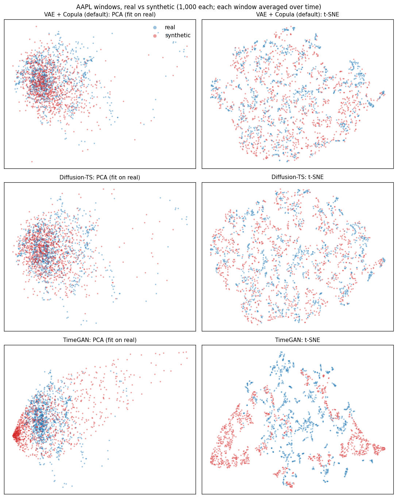

# 🏦 Synthetic Financial Data

> Generate synthetic OHLCV (Open, High, Low, Close, Volume) financial time series with four generative model architectures, evaluate them honestly against real data, and generate labeled structural-break datasets for testing break detectors.

[](https://www.python.org/downloads/)
[](https://pytorch.org/)
[](LICENSE)

---

## Overview

**synfin** is a Python package for generating and evaluating synthetic stock market data.
It implements **four architectures** you can train and compare:

| Model | Description | Status | Reference |
|-------|-------------|--------|-----------|
| **VAE + Copula** | Recurrent VAE conditioned on the volatility regime; Student-t + GARCH noise, correlated across features, with volume–volatility coupling; candle wicks modeled on a Box-Cox scale | **Recommended default** | Kingma & Welling 2014 |
| **Diffusion-TS** | Transformer diffusion with trend/seasonal decomposition | Best stylized facts after the VAE; fails TSTR; slow to train | Yuan & Qiao, ICLR 2024 |
| **Diffusion (DDPM)** | 1D U-Net denoising diffusion, v-prediction | Realistic single windows; weak clustering; fails TSTR | Ho et al., NeurIPS 2020 |
| **TimeGAN** | Recurrent GAN with temporal supervision | Baseline only (see below) | Yoon et al., NeurIPS 2019 |

### Model comparison on real data (AAPL daily, 2015–2024)

Same chronological split and evaluation for every model (see [Evaluation Methodology](#evaluation-methodology)). These are short CPU runs, so treat them as indicative rather than definitive.

| | VAE + Copula | Diffusion-TS | DDPM | TimeGAN |
|---|---|---|---|---|
| Training | 60 epochs, mean of 3 seeds | 150 epochs, batch 32, 1 run | 150 epochs, 1 run | 60 epochs per phase, 1 run |
| Realism score (6 components) | **0.820** | 0.729 | 0.750 | 0.456 |
| Discriminative score (1 = indistinguishable) | 0.883 | 0.719 | **1.000** | 0.000 |
| Stylized-facts score | **0.875** | 0.751 | 0.611 | 0.196 |
| Tails: trimmed kurtosis (real 4.68) | **5.42**¹ | 3.34 | 3.07 | 7.16 |
| Volatility clustering, \|r\| ACF (real 0.208) | **0.213** | 0.192 | 0.086 | 0.552 |
| Same-day corr(volume, \|r\|) (real 0.46) | **0.46** | 0.53 | — | — |
| Same-day corr(return, overnight gap) (real 0.67) | 0.52 | **0.68** | **0.68** | 0.85 |
| Wicks exactly 0 (real 2.0%) | **4.2%** | — | — | — |
| Largest stylized gap (z) | regime dispersion +1.0 | volume–volatility +2.6 | clustering −2.2 | regimes +12 |
| TSTR gap (z; real baseline AUC 0.578) | +3.1 | +4.3 | +5.1 | +4.8 |
| Post-hoc LSTM discriminator AUC (0.5 = indistinguishable) | 0.68 | **0.52** | 0.54 | 1.00 |
| Privacy verdict | ok | ok | ok | collapse |

¹ Mean over 10 draws of 1,000 windows from each of the 3 models. A single 1,000-window sample scatters by a standard deviation of 0.5–1.6 around it (see [Evaluation Methodology](#stylized-facts-score)); the other columns are single samples.

**Read the headline score with its components.** Both diffusion models fail TSTR outright (gap > 4 standard errors): a volatility classifier trained on their data is no better than chance on real data, even though DDPM's individual windows are indistinguishable from real ones (discriminative 1.000). The VAE has the best realism and stylized-facts scores: every stylized fact is within about one standard error of real (the largest gap is regime dispersion, z = +1.0), including the tails, clustering, crash-level regimes and the volume–volatility link (z = −12 before magnitude coupling, ~0 now; the learned couplings of about +0.5 for volume and −0.08 for the ranges track the real same-day correlations). Its TSTR gap is about 3 standard errors on every seed (z = 3.0 / 3.2 / 3.0).

**Magnitude coupling is a trade-off on AAPL** (measured before correlated noise was added). Without it, the VAE's TSTR gaps are within noise (z = 0.6 / 1.9 / 0.9 over 3 seeds) and its realism score is higher (0.830 vs 0.787). With it, two of three seeds have significant TSTR gaps (z = 1.1 / 3.2 / 2.8). On MSFT and JPM the coupled model scores higher on every summary score. The AAPL TSTR cost isn't explained by lagged volume effects: coupling brings the lagged volume–volatility correlations *closer* to real. Coupling also clearly improves held-out likelihood (validation NLL 0.303 → 0.273). Set `magnitude_coupling: false` to trade the volume link back for AAPL-style TSTR.

For reference, real AAPL data from a later, calmer period scores 0.594 against the training period. Its stylized-facts score is 0.483 (thinner tails, less clustering), and it fails TSTR (z = 4.5), partly because of the regime change and partly because it has only ~375 windows to train a classifier on, against 1,000 for the generators.

**Correlated noise fixed the VAE's main giveaway.** The paper-style post-hoc LSTM discriminator (see [Evaluation Methodology](#post-hoc-lstm-suite-timegan-paper)) separated the earlier VAE from real data almost perfectly (AUC 0.96–0.99), although no single feature gave it away: trained on one feature at a time it scored about 0.5. The tell was same-day co-movement. The VAE drew each feature's noise independently, so the close-to-close return and the overnight gap were uncorrelated (−0.01 vs +0.67 in real data). With a learned correlation matrix for each day's noise (`correlated_noise: true`, now the default), the return–gap correlation is +0.50, the LSTM's AUC falls to 0.80 (6 runs: 3 seeds × 2 discriminator seeds), held-out NLL improves from 0.273 to 0.221, the stylized-facts score rises from 0.770 to 0.803, and the realism score from 0.787 to 0.797. For scale, the same LSTM separates the training period from *real* AAPL data of a later period with AUC 0.84. The diffusion models still fool it more often (≈0.5) but fail TSTR and, in DDPM's case, clustering. Two same-day correlations are still too weak: return–high range (−0.09 vs −0.25) and gap–high range (−0.04 vs −0.32). On its own, correlated noise also thinned the tails and weakened the volume link; the next paragraph covers the fix.

**Regime conditioning and noise calibration restored the tails and the volume link.** With correlated noise, the model wrote crash windows off as runs of one-day outliers instead of sustained high-volatility periods: in the most volatile 3% of real windows its standardized residuals had standard deviation 1.17, not 1. Its noise can't regenerate such windows, so the tails thinned (JPM trimmed kurtosis 5.6 vs 9.8 real). Lowering the KL weight, training longer and sampling latents closer to the posterior mean didn't fix it, so the decoder is now conditioned on each window's volatility regime (`regime_conditioning: true`, the log realized volatility of the return). Generation reuses the regime of the training window it samples, so calm and crash-level windows appear at their real frequency. Separately, early stopping left the cross-feature noise parameters short of their optimum: the volume coupling stopped at about 0.35–0.45, while the model's own residuals support about 0.56. After training, `noise_calibration_steps` fits just those parameters (noise mixing and couplings) with the network frozen. Together, on AAPL (3 seeds): the stylized-facts score rises from 0.803 to 0.895, the volume–volatility link from 0.40 to 0.46 (real 0.46), trimmed kurtosis is 4.82 (real 4.68), and the LSTM's AUC falls from 0.80 to 0.78. The likelihood is now conditional on the regime, so held-out NLL isn't comparable with earlier versions.

**The candle wicks are modeled on a Box-Cox scale.** HighRange and LowRange (the upper and lower wicks) are ≥ 0 and heavily right-skewed, but the VAE modeled them as symmetric noise around a mean near 0, and generation clipped everything below 0: 11–13% of generated wicks were exactly 0, against about 2% in real data, and their tails were too short. They are now modeled as `((wick + δ)^λ − 1)/λ` (`wick_transform: true`, `wick_lambda: 0.4`, with the Jacobian in the likelihood). The maximum-likelihood λ (0.1–0.2, close to a log) over-corrects: real log-wicks are left-skewed, and symmetric noise on that scale produced wicks up to 7,000× the median. The transform also compressed the huge crash-day wicks that had been pushing a crash signal into the decoder's shared state, so JPM's return volatility in its most volatile 1% of windows fell to 0.83 of realized and its trimmed kurtosis from 8.4 to 6.2. Feeding the regime straight into the output heads as well (`regime_to_heads: true`) restores it to 8.2 (real 9.8). Against the previous default (AAPL 3 seeds, MSFT and JPM 2 each): wicks at exactly 0 fall to 3–4.5%, wick tail quantiles match real (AAPL 99.9th percentile 14.8× the median, real 16.3×), the window discriminator score rises from 0.65 / 0.79 / 0.80 to 0.88 / 0.96 / 0.94 (AAPL / MSFT / JPM), KS and MMD improve, and the realism score rises from 0.800 / 0.865 / 0.864 to 0.820 / 0.919 / 0.876. The costs: stylized-facts scores dip (0.895 / 0.895 / 0.851 → 0.875 / 0.813 / 0.804, every gap still within 1.6 standard errors), and on MSFT and JPM crash-level windows are somewhat rarer (MSFT 1.0% vs 1.8% real, JPM 1.8% vs 2.6%). The post-hoc LSTM's AUC moves within its own noise (a standard deviation of 0.05–0.07 between discriminator seeds): 0.78 → 0.68 on AAPL, 0.64 → 0.68 on MSFT, 0.67 → 0.72 on JPM. Trained on one feature or one pair of features at a time, it finds the new wicks harder to tell from real than the old ones in every case.

The return–wick and gap–wick correlations are still too weak in Pearson terms (AAPL −0.10 / −0.07 vs −0.25 / −0.32). That gap comes from the 1% of days with the largest overnight gaps, on which real wicks double or triple, especially the upper wick after a gap down; on the other 99% of days the real correlations are only −0.13 to −0.16. Coupling the wicks to the size of the gap shock as well didn't reproduce it.

The VAE column uses the default `posterior` latent sampler. With it, crash-level windows (≥3× median volatility) appear at 1.3% of windows vs 1.8% in the real data; the `copula` sampler smooths these regimes away (1.1% on an earlier version of the model).

**PCA and t-SNE projections** (the TimeGAN paper's visual check, one point per window averaged over time). Synthetic windows from the VAE and Diffusion-TS cover the same region as the real ones, with no collapse. Both cover the sparse high-volatility tail of the real data (right side of the PCA plots) only thinly. TimeGAN shows the failure these plots are meant to catch: a dense collapsed cluster plus a spray of off-distribution windows.



These plots are a sanity check, not proof: averaging over time hides temporal structure, so a generator can overlap perfectly here and still miss clustering. The scores above are the quantitative test.

**Other tickers** (60 epochs). "Independent" is Student-t + GARCH noise with magnitude coupling and posterior sampling (1 run); "previous" adds correlated same-day noise, regime conditioning and noise calibration; "default" adds the wick transform and the regime path to the output heads ("previous" and "default": mean of 2 seeds). The original Gaussian model scored 0.868 on MSFT and 0.788 on JPM; correlated noise alone brought the LSTM's AUC from 0.97 to 0.66 (MSFT) and 0.69 (JPM).

| | MSFT independent | MSFT previous | MSFT default | JPM independent | JPM previous | JPM default |
|---|---|---|---|---|---|---|
| Realism score (6 components) | 0.905 | 0.865 | **0.919** | 0.839 | 0.864 | **0.876** |
| Discriminative | 0.838 | 0.786 | **0.955** | 0.720 | 0.799 | **0.943** |
| Stylized-facts score | 0.839 | **0.895** | 0.813 | 0.792 | **0.851** | 0.804 |
| Post-hoc LSTM AUC (real later period: MSFT 0.84, JPM 0.70) | 0.97 | **0.64** | 0.68 | 0.97 | **0.67** | 0.72 |
| Same-day corr(return, gap) (real: MSFT 0.67, JPM 0.73) | 0.00 | **0.49** | 0.48 | 0.01 | **0.55** | **0.55** |
| Same-day corr(volume, \|r\|) (real: MSFT 0.43, JPM 0.48) | 0.38 | 0.42 | **0.43** | 0.38 | **0.45** | **0.45** |
| Trimmed kurtosis² (real: MSFT 5.45, JPM 9.78) | 7.25 | 4.83 | **5.55** | 11.66 | **8.44** | 8.15 |
| Extreme clustering (real: MSFT 0.52, JPM 0.74) | **0.54** | **0.50** | 0.42 | **0.66** | 0.60 | 0.50 |
| Window vol p99, × median (real: MSFT 4.47, JPM 5.48) | **3.95** | 3.57 | 3.02 | **5.57** | 4.45 | 3.87 |
| Wicks exactly 0 (real: MSFT 2.4%, JPM 1.9%) | — | 12.9% | **4.4%** | — | 10.9% | **3.2%** |

² "Previous" and "default": mean over 10 draws of 1,000 windows per model; "independent": one sample.

The default has the best realism and discriminative scores on both tickers and the most realistic wicks; the previous default keeps slightly better stylized-facts scores, mostly from its more frequent crash-level windows (extreme clustering and the top of the volatility distribution). Every stylized gap is within 2 standard errors; the largest are MSFT's 99th-percentile return size (z = −1.6) and JPM's volume–volatility correlation (z = −1.8, against −3.6 for the independent model). With overlapping windows, the top of the volatility distribution rests on one or two crash episodes, so it is noisy. MSFT's TSTR gap is negative on one seed: a classifier trained on its synthetic data beats one trained on real data, and the score penalizes |z| either way.

**Why TimeGAN is only a baseline:** on return data its recovery network produces smooth paths (lag-1 autocorrelation wrong in every channel), it partially mode-collapses, and it exaggerates the leverage effect about tenfold (−0.74 vs −0.065). A fair rescue would need roughly the paper's ~10,000 joint iterations (~750 epochs here). Its original benchmark used smooth price levels, not near-white-noise returns. It is kept, tested and documented as a reference point, but it isn't the default.

The evaluation suite checks whether generated data reproduces the key **stylized facts** of financial returns:
- 📊 Fat-tailed return distributions
- 📈 Volatility clustering
- 🔗 Volume-volatility correlation
- 📉 Leverage effect

---

## Architecture Diagrams

### TimeGAN (3-Phase Training, baseline)

```
Phase 1 — Autoencoder:   X ──→ Embedder ──→ H ──→ Recovery ──→ X̂
Phase 2 — Supervisor:         H ──→ Supervisor ──→ Ŝ
Phase 3 — Joint:         Z ──→ Generator ──→ Ê ──→ Supervisor ──→ H_hat
                               Discriminator(H_real vs H_hat) adversarial loss
```

### Diffusion Model (DDPM)

```
Training:   x_0 ──→[add noise t steps]──→ x_t ──→[UNet1D]──→ v_pred  (MSE vs v = √ᾱ·ε − √(1−ᾱ)·x_0)
            (v-prediction: recovering x_0 from an ε-prediction divides by √ᾱ, which amplifies
             errors up to ~20,000x near t = T and made samples far too dispersed)
Sampling:   x_T ~ N(0,I) ──→[denoise T steps]──→ x_0
```

### VAE + Copula

```
Encoder:  X ──→[LSTM]──→ (μ, σ²)  ──→[reparameterize]──→ z
Regime:   r = log realized volatility of the window's returns
Wicks:    modeled as ((wick + δ)^λ − 1)/λ, λ = 0.4 (inverted after sampling)
Decoder:  (z, r) ──→[LSTM]──→ [h_t, r] ──→ (mean_t, σ_t) ──→ X̂ = mean + σ·u,  u_t = ρ·u_{t-1} + √(1−ρ²)·ε_t
          ε_t: Student-t (learned df), mixed across features by a learned correlation
          matrix (same-day co-movement), with GARCH(1,1) volatility feedback and every
          feature's shock coupled to the size of the return shock (big moves, high volume);
          ρ, df, GARCH α/β and the couplings are learned per feature; the likelihood is exact
          (given r); after training, the mixing and couplings are refit with the network frozen
Latents:  store each training window's posterior N(μ_i, σ_i²) and regime r_i  (also fits a copula)
Generate: pick i at random, z ~ N(μ_i, σ_i²), r = r_i ──→ Decoder ──→ X_synthetic
          (default "posterior" sampler: reproduces rare regimes such as crash-level volatility
           at their real frequency; "copula" and "prior" samplers also available)
```

---

## Project Structure

```
synthetic-financial-data/
├── pyproject.toml            # Package metadata, dependencies, entry points, tool config
├── requirements.txt          # `-e .` (dependencies live in pyproject.toml)
├── setup.cfg                 # flake8 settings only
├── Makefile                  # Common developer commands
├── .github/workflows/ci.yml  # Lint + tests + smoke test on every push/PR
│
├── configs/                  # YAML configs; model files pull in default.yaml via `defaults:`
│   ├── default.yaml          # Data, training and evaluation defaults
│   ├── timegan.yaml / diffusion.yaml / diffusion_ts.yaml / vae_copula.yaml
│   └── diffusion_ts_quick.yaml   # Short Diffusion-TS run for CPU demos
│
├── data/                     # raw/, processed/, synthetic/, structural_breaks/ (gitignored)
├── notebooks/                # Exploration, training, evaluation, visualization
│
├── src/synfin/
│   ├── cli/                  # synfin-download/-train/-generate/-evaluate/-structural-breaks
│   ├── data/                 # Download, features, leak-free preprocessing, OHLCV rebuild
│   ├── models/               # timegan/, diffusion/, diffusion_ts/, vae_copula/, factory.py
│   ├── training/             # Trainer, EMA, LR schedulers, self-describing checkpoints
│   ├── evaluation/           # Statistical tests, stylized facts, TSTR, privacy, post-hoc LSTM
│   ├── structural_breaks/    # Labeled structural-break data generator (ADIA formats)
│   ├── constraints/          # OHLCV post-processing constraints
│   ├── visualization/        # Plotting utilities, PCA/t-SNE projections
│   └── utils/                # Config, logging, seed, device
│
├── scripts/                  # Thin wrappers around synfin.cli + smoke_test.py
└── tests/                    # pytest suite, incl. an end-to-end CLI pipeline test
```

---

## Installation

### Prerequisites
- Python 3.9+
- pip

### Quick Install

```bash
git clone https://github.com/AndrewFSee/synthetic-financial-data.git
cd synthetic-financial-data

# Optional: pick a PyTorch build before installing the package
pip install torch --index-url https://download.pytorch.org/whl/cpu     # CPU-only machines (far smaller)
pip install torch --index-url https://download.pytorch.org/whl/cu128   # NVIDIA GPUs; RTX 50-series needs CUDA 12.8+

pip install -e .            # or: make install
pip install -e ".[dev]"     # with tests, linters, Jupyter (make install-dev)
```

Training uses the GPU automatically when one is available (`training.device: "auto"`); checkpoints trained on a GPU load and generate on CPU-only machines. On Windows, `make` usually isn't installed: every Makefile target is a thin wrapper around a `synfin-*` command (see [Makefile Reference](#makefile-reference)), and when running the linters by hand, set `PYTHONUTF8=1` so isort can read files containing non-ASCII characters.

---

## Quick Start

Each step consumes the previous step's output. `make pipeline MODEL=<model> TICKER=<ticker>` runs steps 2–4.

### 1. Download financial data

```bash
synfin-download --tickers AAPL MSFT        # defaults come from configs/default.yaml
```

Writes `data/raw/<TICKER>_1d.parquet`.

### 2. Train a model

```bash
synfin-train --model vae_copula            # or diffusion_ts, diffusion, timegan
synfin-train --model diffusion_ts --config configs/diffusion_ts_quick.yaml --ticker MSFT
```

Writes:
- `data/processed/<TICKER>_windows.npz`: the scaled train/val/test windows, plus the scaler and feature names.
- `checkpoints/<model>.pt`: a self-describing checkpoint with the architecture, config, feature names and scaler.

For models with a validation split, the checkpoint holds the best-validation weights (EMA weights when `ema_decay` is set).

### 3. Generate synthetic data

```bash
synfin-generate --checkpoint checkpoints/vae_copula.pt --num-samples 1000
```

The model is rebuilt from the checkpoint and its samples are un-scaled to the original feature units. Output goes to `data/synthetic/<model>_<TICKER>.npz` with:
- `windows`: generated feature windows
- `feature_names`
- `ohlcv`: valid OHLCV bars rebuilt from the generated returns

Diffusion sampling and VAE copula/temperature settings come from the config's `generation:` section and can be overridden with flags.

### 4. Evaluate quality

```bash
synfin-evaluate \
    --real-data data/processed/AAPL_windows.npz \
    --synthetic-data data/synthetic/vae_copula_AAPL.npz \
    --output reports/vae_copula_AAPL \
    --rnn-metrics \
    --plot-projections reports/vae_copula_AAPL/projections.png   # both optional
```

The real training windows are the reference, and the never-seen test windows are the holdout for the TSTR and privacy checks. Every `scripts/*.py` file is equivalent to the matching `synfin-*` command.

---

## Configuration

Model configs extend `configs/default.yaml` through a `defaults:` list (resolved by `synfin.utils.config.load_config`). Every key in the shipped configs is read by the code.

```yaml
# configs/default.yaml (excerpt)
data:
  feature_set: "returns"     # stationary features (recommended) or "levels" (legacy)
  normalization: "zscore"    # scaler fit on training rows only
  window_size: 30
  train_ratio: 0.7
  val_ratio: 0.15
training:
  seed: 42
  device: "auto"             # CUDA > MPS > CPU
evaluation:
  tstr_task: "volatility"    # or "direction"
```

Diffusion and VAE configs also set `gradient_clip`, `lr_scheduler` (`cosine` with `warmup_steps`, or `reduce_on_plateau`) and `ema_decay`. TimeGAN uses `lambda_e`, `lambda_s` and `gamma`.

---

## Data Module

### Feature sets

The default `returns` set is stationary, and generated windows map back to valid OHLCV bars (`synfin.data.preprocess.windows_to_ohlcv`):

| Feature | Definition |
|---------|------------|
| `LogReturn` | `log(C_t / C_{t-1})` |
| `OpenGap` | `log(O_t / C_{t-1})` |
| `HighRange` | `log(H_t / max(O_t, C_t))` ≥ 0 |
| `LowRange` | `log(min(O_t, C_t) / L_t)` ≥ 0 |
| `LogVolumeRel` | `log1p(V_t)` minus its trailing 20-bar mean |

The legacy `levels` set (raw `Open/High/Low/Close/Volume`, `LogReturn`, `LogVolume`, `DollarVolume`) is still available. Price levels trend over the years, though, so models trained on them mostly learn the training period's price level.

Optional scale-free indicators (`use_rsi`, `use_macd`, `use_bollinger`, `use_atr`) add `RSI/100`, `MACD_Hist/Close`, `BB_Width` and `ATR/Close`.

### No look-ahead

Rows are split chronologically into train, validation and test *before* anything is fitted. The scaler sees training rows only, and each split is windowed separately, so no window straddles two splits.

---

## Evaluation Methodology

Pass windows in original units together with their feature names. Columns are found by name, and distance-based metrics use features standardized with the real data's statistics.

### Statistical Tests
- **KS test**: per-feature, on one random timestep per window so rows are close to independent. The realism score uses the KS *statistic*, because p-values from tens of thousands of pooled rows are always 0.
- **MMD**: unbiased MMD² with an RBF kernel, median-heuristic bandwidth and O(N·M) memory.
- **ACF comparison**: autocorrelations pooled *within* windows, never across window boundaries.

### Stylized Facts (computed on unscaled log returns)
- **Fat tails**: excess kurtosis, plus robust measures: kurtosis with the top 0.1% trimmed, and the 99% and 99.9% quantiles of |r| in standard deviations. Raw kurtosis is dominated by a few extreme values (for AAPL, dropping the top 0.1% cuts it from 6.6 to 4.7), so compare the robust measures when judging tails.
- **Extreme moves (size-matched)**: the largest |r| of synthetic samples drawn with as many days as the real data, compared with the real maximum (repeated draws). The maximum of a fat-tailed sample grows with sample size, so raw maxima from 30,000 generated days and ~1,750 real days aren't comparable. A calibrated generator gives a median ratio near 1 and exceeds the real maximum about half the time.
- **Volatility clustering**: ACF of |r| and r².
- **Leverage effect**: correlation between r_t and future |r_{t+k}|.
- **Volume-volatility correlation**: correlation between volume and |r|.

### TSTR Benchmark (Train on Synthetic, Test on Real)
A logistic classifier is trained on synthetic windows and tested on held-out real windows, against a train-on-real (TRTR) baseline. The real test set is small (~350 overlapping windows), so the AUC gap is judged against its own noise: a paired block bootstrap over the test windows gives its standard error (typically 0.03–0.04), and the score component is `max(0, 1 − |z|/4)`, as for the stylized terms. The default task predicts whether the next step's |return| is above the real median, which volatility clustering makes learnable. Next-day *direction* is also available, but it is close to unpredictable, so the gap says little. Label thresholds come from the real data, so any monotone scaling works. If a classifier can't be trained on the synthetic data at all, the TSTR score is 0.

### Privacy and Collapse (calibrated against a real holdout)
A generator that collapses toward the dense centre of the data produces samples close to many training records without copying any of them. Raw distance-to-closest-record can't tell that apart from memorization, so the two are measured separately:

- **Memorization rate**: for each sample, the ratio d1/d2 of its distances to the nearest and second-nearest training records. A copy sits on one record (ratio ≈ 0); a collapsed sample sits between many (ratio ≈ 1). The rate is the share of synthetic samples below the 5th percentile of the holdout's ratios, so about 0.05 is expected without memorization.
- **Collapse diagnostics**: spread (median std ratio vs real) and nearest-record coverage (distinct nearest training records, relative to an equal-sized holdout sample). Either below 0.5 flags collapse.
- **Verdict**: `memorization` if the rate is above twice the expected rate, otherwise `collapse` if collapse is flagged, otherwise `ok`.
- **NNDR** (median nearest-record distance, synthetic vs holdout) is still reported for reference.

These checks cover the *generated data*. The checkpoint is a separate matter: with the default `posterior` latent sampler, a VAE checkpoint stores every training window's encoder posterior and volatility regime (a lossy encoding of the training data), so treat it as derived from the training data when sharing it. Use `latent_sampler: copula` if that matters.

### Discriminative Score
A gradient-boosted classifier tries to tell real windows from synthetic ones using per-window dynamics features: volatility level, tail weight, autocorrelation of |x|, and leverage. It's scored with cross-validated ROC AUC on contiguous-block folds, so overlapping real windows can't leak between folds. KS and MMD are nearly blind to temporal structure, so this is the component that catches i.i.d. noise with the right mean and variance.

### Stylized-Facts Score
The components above judge windows mostly one at a time, so they barely see the differences *between* windows (calm vs turbulent periods) that make up much of volatility clustering. This component scores six robust stylized facts of the returns: trimmed kurtosis, the 99% quantile of |r|, the ACF of |r|, extreme clustering, regime dispersion (the spread of log window volatility) and the volume–volatility correlation. Each gap is judged against its own sampling noise, `z = (synthetic − real) / √(SE_real² + SE_synthetic²)`, with standard errors from bootstraps (block bootstrap for the overlapping real windows). Each term is `max(0, 1 − |z|/4)`: a gap within noise scores about 0.75–1, 2 standard errors scores 0.5, and 4 or more scores 0. Fixed tolerances don't work, because independent samples of the *same* process at AAPL-like sizes scatter by 10–50% on several of these statistics. The per-term `z` values in the report show which fact a model gets wrong.

The synthetic side of these statistics is noisy too, and the score accounts for it. Read raw values from a single sample with care: trimmed kurtosis from one 1,000-window sample of a fixed model scatters with a standard deviation of 0.5–1.6 between draws (more for fat-tailed tickers like JPM), so compare models on averages over several draws or on the `z` values.

The **realism score** is the mean of six components, each in [0, 1]: `1 − KS statistic`, `1 − √MMD²`, the TSTR score (`1 − |z|/4` of the AUC gap), the privacy score (`1 −` excess memorization rate), the discriminative score `1 − 2·(AUC − 0.5)`, and the stylized-facts score. They are all reported under `realism_components`.

As a sanity check on a known GARCH-t process, held-out data from the same process scores 0.89, time-shuffled data 0.75, and i.i.d. noise with matched mean and variance 0.57. The stylized-facts component alone gives 0.76, 0.48 and 0.00: shuffling keeps the tails but destroys every clustering term.

### Post-hoc LSTM Suite (TimeGAN paper)
`--rnn-metrics` runs the two post-hoc scores from the TimeGAN paper (Yoon et al., 2019). They are reported under `posthoc_rnn` and aren't part of the realism score.

- **Discriminative**: a 2-layer LSTM classifies whole windows as real or synthetic. It reports held-out accuracy, `|accuracy − 0.5|` (the paper's score) and AUC. Unlike the gradient-boosted discriminator, it sees the raw sequences, so it catches cross-feature and within-window patterns that summary features miss.
- **Predictive**: an LSTM trained on synthetic windows predicts every feature one step ahead. Its mean absolute error on the real holdout is compared with the same LSTM trained on real data (ratio TSTR / TRTR). On daily returns this is uninformative: the next step is close to unpredictable, so even the real-trained model doesn't beat predicting the training mean (standardized MAE 0.602 vs 0.575), and every generator except TimeGAN (1.19) scores a ratio near 0.9. It is kept for parity with the paper and for smoother data.

The real windows for the discriminator are split leak-free. Overlapping windows are grouped into blocks of two window lengths, test blocks are drawn at random across the whole period, and training windows that overlap a test window are dropped. A single chronological test block would be worse than leaky: on AAPL the test windows came from a different regime than the training windows, and the classifier scored well *below* 0.5.

### PCA and t-SNE Projections
`--plot-projections PATH` saves the paper's visual check: real and synthetic windows (each averaged over time, features standardized with the real statistics) projected with PCA fit on the real data, and with a joint t-SNE. `synfin.visualization.plot_projections` also offers `reduce="flatten"`, which keeps every time step. Overlap means coverage; a dense synthetic clump inside the real cloud means mode collapse.

---

## Structural Break Datasets

`synfin.structural_breaks` generates labeled univariate return series for testing structural-break / change-point detectors. Output uses the ADIA Lab competition file layouts, so existing ADIA pipelines can read it directly.

```bash
# 2025 offline layout: break (if any) exactly at the pre/post boundary
python scripts/generate_structural_breaks.py --preset adia_offline --n-series 10000 --report

# 2026 real-time layout: break-free history + online segment, break anywhere online
python scripts/generate_structural_breaks.py --preset adia_realtime --split test --seed 1

# Easier/harder breaks, or real AAPL returns as the no-break process
python scripts/generate_structural_breaks.py --magnitude-scale 2.0
python scripts/generate_structural_breaks.py --bootstrap-from data/raw/AAPL_1d.parquet
```

Files are written to `data/structural_breaks/<preset>/`: `X_<split>.parquet` and `y_<split>.parquet` (plus `y_<split>_index.parquet` for real-time), in the same schema as the competition data. `meta_<split>.parquet` holds the ground truth that real data lacks: break type, effect size, τ, ramp length, decoys and every process parameter before and after the break.

**Model.** Each series is `mu + sigma * x_t`, where `x_t` is a unit-variance AR(1)-GARCH(1,1) process with Student-t shocks and an optional slow log-volatility factor. Breaks move one parameter group, instantly or along a linear ramp: `mean`, `variance`, `ar`, `tails` (shock df), `garch` (clustering intensity), or a `compound` of two. Dynamics breaks preserve variance. Transient decoys (single outliers and decaying volatility bursts) are added to break and no-break series alike, so detectors are tested against realistic false positives.

**Calibration.** The presets were tuned against the public ADIA training sets. The no-break segments reproduce the real data's tail weight, autocorrelation spread, volatility clustering and outlier frequency. Five simple two-sample detectors score within about 0.035 AUC (offline) and 0.015 AUC (real-time) of their AUC on real data.

**Validation with a real competition detector.** We ran a production-grade real-time detector (a streaming-feature + LightGBM ensemble from an ADIA real-time competition entry) through one harness with 400 training and 600 test series per run, scored by TS-AUC with bootstrap standard errors (~0.02):

| Data the detector is trained and tested on | TS-AUC |
|---|---|
| Real ADIA training series (2 seeds) | 0.586, 0.576 (mean 0.581) |
| synfin `adia_realtime` preset (2 seeds) | 0.556, 0.582 (mean 0.569) |
| Toy generator (i.i.d. Gaussian, large breaks) | 0.947 |

- **Synfin data is as hard as the real data**, within noise. A generator with unrealistic breaks makes detection look far easier than it is, so local cross-validation on it overstates a detector's quality badly.
- **Trained on synfin, tested on real series:** the detector scores 0.598 and 0.547 (seeds 0 and 10), against 0.586 and 0.576 when trained on real series, so it transfers within noise.
- **This transfer test can't distinguish generators at this size**, though: a detector trained on the toy data also scores 0.588 on real series, because the detector's features are hand-built and training only weights them.
- **Per break type, only the broad pattern is reliable** (single types swing between seeds): variance breaks are the easiest to detect (0.62–0.65), and AR and tail breaks the hardest (0.47–0.55).

```python
from synfin.structural_breaks import generate, get_preset, auc_report, ts_auc

ds = generate(5000, get_preset("adia_offline"), seed=0)
scores = my_detector(ds.series, ds.meta["n_hist"])          # one score per series
print(auc_report(scores, ds.meta))                           # AUC by break type / effect size / decoy
# real-time: ts_auc({id: per_step_scores}, ds.meta) -> time-stratified AUC
```

---

## Running Tests

```bash
# Run all tests
make test

# Run specific test module
python -m pytest tests/test_models/test_timegan.py -v
python -m pytest tests/test_cli/ -v          # end-to-end train -> generate -> evaluate
python scripts/smoke_test.py                 # all four models on dummy data
```

---

## Makefile Reference

`MODEL` (default `vae_copula`), `TICKER` (default `AAPL`) and `NUM_SAMPLES` can be overridden, e.g. `make pipeline MODEL=diffusion_ts`.

| Command | Description |
|---------|-------------|
| `make install` / `make install-dev` | Install the package (with dev extras) |
| `make download` | Download `TICKER` |
| `make train` | Train `MODEL` on `TICKER` (also `train-timegan`, `train-diffusion`, `train-diffusion-ts`, `train-vae`) |
| `make generate` | Sample from `checkpoints/MODEL.pt` |
| `make evaluate` | Evaluate the generated windows against `TICKER`'s real windows |
| `make pipeline` | train → generate → evaluate |
| `make structural-breaks` | Generate offline + real-time structural-break datasets |
| `make smoke` | End-to-end smoke test on dummy data |
| `make test` | Run unit tests |
| `make lint` / `make format` | flake8, black, isort |
| `make clean` | Clean caches and build artifacts |
| `make all` | install → download → pipeline |

---

## References

1. **TimeGAN**: Yoon, J., Jarrett, D., & van der Schaar, M. (2019). *Time-series Generative Adversarial Networks*. NeurIPS 2019. [arXiv:1906.09592](https://arxiv.org/abs/1906.09592)

2. **DDPM**: Ho, J., Jain, A., & Abbeel, P. (2020). *Denoising Diffusion Probabilistic Models*. NeurIPS 2020. [arXiv:2006.11239](https://arxiv.org/abs/2006.11239)

3. **DDIM**: Song, J., Meng, C., & Ermon, S. (2020). *Denoising Diffusion Implicit Models*. ICLR 2021. [arXiv:2010.02502](https://arxiv.org/abs/2010.02502)

4. **VAE**: Kingma, D.P., & Welling, M. (2014). *Auto-Encoding Variational Bayes*. ICLR 2014. [arXiv:1312.6114](https://arxiv.org/abs/1312.6114)

5. **FinDiff**: Sattarov, T. et al. (2023). *FinDiff: Diffusion Models for Financial Tabular Data Generation*. [arXiv:2309.01472](https://arxiv.org/abs/2309.01472)

6. **Quant GANs**: Wiese, M. et al. (2020). *Quant GANs: Deep Generation of Financial Time Series*. Quantitative Finance. [arXiv:1907.04155](https://arxiv.org/abs/1907.04155)

7. **Stylized Facts**: Cont, R. (2001). *Empirical properties of asset returns: stylized facts and statistical issues*. Quantitative Finance, 1(2), 223–236.

---

## License

This project is licensed under the **MIT License** — see the [LICENSE](LICENSE) file for details.